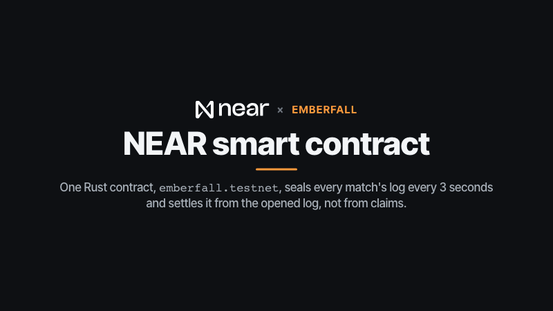
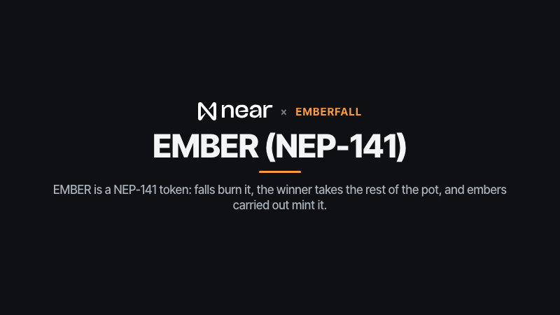
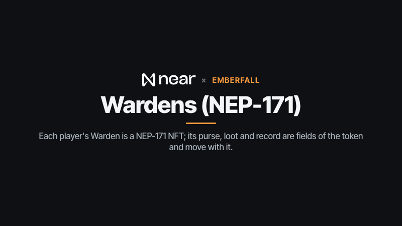
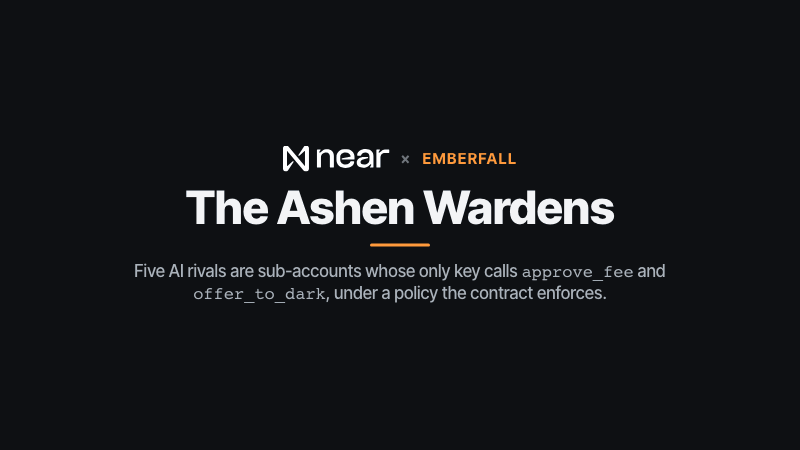
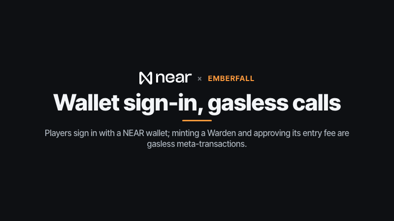
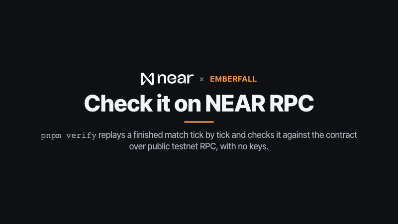
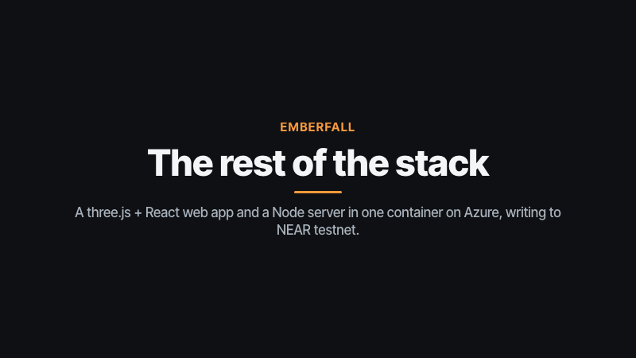

# Emberfall

> Part of the **NEAR Arcade** submission for NEAR HACKATHON (https://arcade.lopeselio.online, [github.com/lopeselio/near-arcade](https://github.com/lopeselio/near-arcade)); the author's other submission is **Signalfire** ([github.com/lopeselio/signalfire](https://github.com/lopeselio/signalfire)).

A torchlit battle arena on NEAR, in voxels. Every Warden carries a torch and **sees only what it lights**. Gather embers, fight with a swing and a dash (every Warden has 8 hearts), and stay inside the light while **the dark closes in**. A match lasts about two and a half minutes (at most 3:00). The last Warden standing wins; if the clock runs out, the living Warden carrying the most embers does.

The fog is kept honest without a TEE: the server commits a hash of the match seed onchain before the first tick, sends each player only what their torch reveals, and **seals every player's inputs and position onchain every 3 seconds**. At the end the seed and the whole log are opened, and the contract rebuilds every seal before it burns or pays a single EMBER. `pnpm verify <matchId>` replays the match from that log.

Built for NEAR HACKATHON (Nov 2026). In the NEAR Arcade, Emberfall is claimed for the tracks **Games With Real Economies** (games), **NFTs That Do Something** (nfts) and **Memecoins With Mechanics** (memecoins). Design: [DESIGN.md](DESIGN.md).

- **Play it hosted:** https://emberfall.lopeselio.online/ (also in the arcade at https://arcade.lopeselio.online/emberfall). Guests need no wallet.

- Contract (testnet): [`emberfall.testnet`](https://testnet.nearblocks.io/address/emberfall.testnet): EMBER (NEP-141), Wardens (NEP-171), sealed matches.
- Referee: [`emberfall-ref.testnet`](https://testnet.nearblocks.io/address/emberfall-ref.testnet). Gasless relayer: [`emberfall-relay.testnet`](https://testnet.nearblocks.io/address/emberfall-relay.testnet).
- AI rivals (sub-accounts with function-call keys only): `brannoc.`, `gloam.`, `wick.`, `moth.`, `tallow.emberfall.testnet`.

## Try it (do X, see Y)

Every step below works on the hosted game, https://emberfall.lopeselio.online/. To run it yourself:

```bash
pnpm install
pnpm build            # the web app
pnpm start            # http://localhost:8831 (server + built web app)
```

With no NEAR keys, run `CHAIN=0 pnpm start`: everything plays the same, but nothing is written onchain (the results say "Offline mode").

1. **Open https://emberfall.lopeselio.online/** (or http://localhost:8831). You see the EMBERFALL title over a slowly orbiting voxel ruin lit by braziers, and panels for *Your Warden*, *EMBER supply* (in existence / minted / burned / today's mint against its cap, plus the last settlements), the *Wardens' ledger*, *The Ashen Wardens* (their NEAR accounts and what they did onchain) and *Recent matches*.
2. **Pick a difficulty, then press "Fight the Ashen Wardens".** Under the button, **Easy / Normal / Hard** (default Normal; your pick is remembered on this device, and a room's host can change it in the lobby) sets how well every AI rival plays: how fast they react, how true they aim, how often they swing (a ranked match never runs below Normal). The first time, a six-step walkthrough explains the torch and the fog, the controls, embers, the dark, winning and what goes onchain (reopen it any time with **How to play** in the header, a **?** button on a phone). Then a room fills with three AI rivals, a 3-2-1 countdown plays, and one rival taunts you (with a NEAR AI key the line is marked "✓ NEAR AI TEE").
3. **Play.** WASD/arrows move, **the mouse aims** (a small wedge on the ground shows where your swing lands), **click or Space** swings your torch, **right-click or Shift** dashes; a gamepad works too (left stick, right stick to aim, A swing, B dash); on a phone, drag on the left half and tap **Swing**/**Dash**. Hits freeze the frame for an instant, shake the camera and float a "-1"; embers drift towards you when you're close and pop "+1". You see a warm circle around you; outside it the ruins are dim grey-blue and **no Warden or ember is drawn there, because the server never sent it**. Walk over glowing embers to carry them (the gold bar top-left: the fuller it is, the further away rivals can see you) and watch rivals appear only as they enter your light. The minimap shows only the ground your torch has revealed. Your heart bar (top left) reads **8 / 8 ♥** and every Warden's name tag shows 8 pips; each hit takes one. The clock in the top bar counts down from **3:00**, and the line under it counts down to the dark: at **1:50 left** (1:10 into the match) the violet wall starts shrinking (the minimap shows it), and with 0:05 left only a small circle remains. Its wall pulses when it's at your back; step outside and the screen pulses violet and you lose a heart a second (it pulses red when you're down to three hearts).
4. **The end.** The line above the results says your place, how long it lasted and which difficulty the Ashen Wardens played on (e.g. "Ashen Wardens on Normal"). The results table shows everyone's placement, who stood, who fell and when, embers and kills, and what EMBER each Warden earns. While the referee opens the sealed log the line counts it ("Opening the sealed log onchain: 20/42 chunks opened and checked by the contract…"); after a minute or two (one `open_chunks` transaction per 10 chunks, then `settle_match`) it changes to **"✓ Opened and settled onchain: the contract rebuilt every seal."**; open **N transactions** to see `create_match`, one `seal` per 3 s of play, the `open chunks` batches and `settle_match` on nearblocks. **opened log (JSON)** is the full proof bundle. **Watch the replay** re-runs the whole match in your browser from that log (through your torch, 1×/2×/4×, scrubbable) and shows "✓ the opened log rebuilds all N chunks of seals · ✓ it folds into the contract's chain head" (read straight from a public NEAR RPC).
5. **Check it yourself**, with no keys and without trusting our server:

   ```
   pnpm install
   pnpm verify m-mwdkd21i-268412 --host https://emberfall.lopeselio.online   # a hosted match (the default host)
   pnpm verify <matchId> --host http://localhost:8831                        # a match on your local server
   ```

   The results screen prints the exact command for your own match. Without `--rpc` it reads the contract through several public testnet RPCs (drpc, intea, fastnear), retrying with backoff if one rate-limits.

   It prints the match's rules version (new matches are v4) and checks it against the one committed onchain at `create_match` (older matches have none stored and must be v1–v3), checks no seat ever shows more hearts than that version allows, checks the seed against the committed hash, rebuilds every seal and the chain head and compares them with the contract, replays the match tick by tick (re-making every bot decision from that bot's own fogged view), checks every 3-second state, and recomputes the burn, prize and mint. Output for that hosted match is below.
6. **Multiplayer.** **Create a room**, send the 4-letter code or the `?room=CODE` link; friends **Join** with it (up to 6, guests welcome). The host can add Ashen Wardens; everyone presses **Ready**. **Play again** keeps the room together.
7. **Sign in with NEAR** (top right; NEAR Connect: Meteor, Intear, HOT, MyNearWallet, …). The wallet signs "Sign in to <host>" (NEP-413). In *Your Warden*, **Mint my Warden** (free, gasless: a NEP-366 meta-transaction paid by `emberfall-relay.testnet`) gives you an NFT with a 30 EMBER purse; **Allow 5 EMBER entry fee** makes your matches **ranked**. Your card is the NFT's own onchain SVG, regenerated from its purse, record and loot; a Cinder Crown (a win), Shade Fang (a kill) or Lantern Glass (8+ embers carried out) changes your torch's flame colour in game.
8. **Headless:** `pnpm e2e https://emberfall.lopeselio.online` (or `pnpm e2e` for http://localhost:8831; needs the `near` CLI for a faucet account; `E2E_RPC=<url>` picks another public RPC) creates a fresh faucet account, signs in, mints and approves gaslessly, plays a ranked match over the WebSocket steered only by the fogged views it receives, waits for settlement, and transfers the Warden to a second account to show the purse goes with it.

### A live run against the hosted game (testnet, 12 Nov 2026)

`pnpm e2e https://emberfall.lopeselio.online` (the faucet was rate-limiting, so the test account is a funded sub-account):

```
▶ create emberfall-e2e-mwdkclwz.testnet from the testnet faucet
  (the faucet is rate-limited: using e2e-mwdkclwz.emberfall.testnet, funded by its parent account)
  ✓ account funded

▶ sign in: Better Auth + better-near-auth (the wallet signs "Sign in to <host>")
  ✓ session cookie set; the server sees e2e-mwdkclwz.emberfall.testnet

▶ mint a Warden and approve the entry fee, gasless (NEP-366 meta-transactions through the relayer)
  ✓ mint_warden 8xThfbaFM6Vru3kitC8buruCYSDm21efmfkHkA9JpezU
  ✓ approve_fee AysPcERBbSFmnz7nNunfkKwctE6cVruLnbQxrNp1Pp56
  ✓ warden-15 holds 30 EMBER

▶ play a ranked match against three Ashen Wardens over the WebSocket
  ✓ match m-mwdkd21i-268412: ranked=true, fee 5; seed hash bbc15837c4416676… committed before the first tick
  ✓ Sister Gloam: “Your light only helps me find your shadows.” (signed by NEAR AI TEE)
  ✓ over: Sister Gloam won; E2E Warden fell, 1 kills; Wick fell; Moth fell, 1 kills; Sister Gloam alive, 26 embers, 1 kills

▶ wait for the seals to be opened and the match settled onchain
  ✓ create_match       https://testnet.nearblocks.io/txns/95fX9Av4PZ8jo4wru9bDJgUMUVkfQSX7wwEht2ZuU7p1
  ✓ open chunks 0–9    https://testnet.nearblocks.io/txns/7PbSvmrJgWH3jnoviekF49t1vEbs13NvXxyv6B2yoVZf
  ✓ open chunks 10–19  https://testnet.nearblocks.io/txns/GquwRUbB12n5WDP91jPSDvK13Gmca7k46VGFKphbV8qH
  ✓ open chunks 20–29  https://testnet.nearblocks.io/txns/4rgzGZhdcQyNE5LrWCMPkHtuvxUnNv4bMC7caPdwpi7R
  ✓ open chunks 30–39  https://testnet.nearblocks.io/txns/24ymf4FRAT6FYyEMPdp6JmF7uBsueV2XWX9eVpYt8hU3
  ✓ open chunks 40–41  https://testnet.nearblocks.io/txns/42wh8DryQLN1qcXzU9h696HDB52qK1KKqY6YqJraiWfb
  ✓ settle_match       https://testnet.nearblocks.io/txns/E5qu1Y9nUhGgchzywYHNfUYfNPfXV6QLLhqx2xhaABJ8
  ✓ 42 seal transactions (one every ~3 s of play)
  ✓ contract: winner seat 3, burned 9, prize 11, minted [0, 0, 0, 26]
  ✓ EMBER supply 827 → 844 (minted 934, burned 90)
  ✓ warden-15 purse 25 EMBER; NFT reads “E2E Warden · Kindling”

▶ transfer the Warden NFT: its purse, loot and record go with it
  ✓ warden-15 now belongs to buyer.e2e-mwdkclwz.emberfall.testnet with 25 EMBER and 1 match(es) on its record

all player steps passed. Check the match yourself:
  pnpm verify m-mwdkd21i-268412 --host https://emberfall.lopeselio.online
```

`pnpm verify m-mwdkd21i-268412 --host https://emberfall.lopeselio.online` (run 12 Nov 2026):

```
match m-mwdkd21i-268412 on emberfall.testnet: E2E Warden, Wick, Moth, Sister Gloam
rules v4, bots on normal

✓ the contract has this match
✓ the rules version matches the one committed at create_match  v4
✓ no seat ever shows more than 8 hearts
✓ the revealed seed matches the hash committed at create_match  bbc15837c4416676
✓ the match was set up from that seed (arena, embers, salts)
✓ every opening rebuilds its seal (42 chunks × 4 seats)
✓ the seals fold into the contract's chain head  3bb9dd8d74abc600
✓ the contract opened every chunk and re-folded the same head
✓ every bot input is what that bot decides from its own fogged view  1726 bot inputs
✓ every logged human input replays as logged
✓ the replay passes through every sealed chunk state (42 chunks)
✓ the replay ends where the server's match ended (tick 2477)  c2a0b76806298423
✓ the final states match what the contract opened
✓ the contract settled it
✓ winner: Sister Gloam
✓ pot 20 EMBER: 9 burned (3 fell), 11 to the winner
✓ minted for embers carried out: [0, 0, 0, 26]

1 AI line(s), 1 signed by the NEAR AI enclave (signer 0xfdbd7952498b333206f360d71d97a1e0961e8ddf)

all checks passed
```

Matches from before v4 verify too. `pnpm verify m-mw9m7kl1-79aadb --host https://emberfall.lopeselio.online` (a hosted rules v1 match from 9 Nov) prints `✓ the rules version matches the one committed at create_match  (none stored: a v1–v3 match)` and `✓ no seat ever shows more than 5 hearts`, and every check passes. `m-mwdf0yat-b30568` is another hosted v4 match that passes.

## How it works

```
apps/web          three.js voxel arena + React HUD (Vite); NEAR Connect wallet; guests need no wallet
apps/server       rooms (20 Hz authoritative match, fogged views over WebSocket), the chain queue,
                  the Ashen Wardens, Better Auth + gasless relayer, verify and e2e CLIs
packages/rules    arena, match, fog views, bots, seals, settlement (deterministic, integer maths, isomorphic)
contracts/emberfall  Rust near-sdk 5.29: EMBER (NEP-141), Wardens (NEP-171), seals, openings, settlement, agent policies
```

- **The match** is `packages/rules`: 20 ticks a second, integer positions (1 tile = 100 units), a 128-bit seeded generator inside the state, no `Math.random`/`Date`/DOM. The same code runs on the server, in `pnpm verify` and in the tests.
- **The fog.** `viewFor(state, seat)` is the only thing a client ever receives: its own Warden, the Wardens and embers within its torch radius (6.5 tiles, blocked by walls; carried embers make a Warden visible from further away), the ring, the clock. Events far away are dropped, except that someone fell. Bots get exactly the same `viewFor`; they never read the full state.
- **Sealed logs.** The server picks a secret seed; `create_match` records `sha256(seed)` and takes entry fees into the pot. Every 60 ticks, for each seat, `seal = sha256("emberfall|seal|match|seat|chunk|salt|inputs|x,z,hp,embers,kills")` with `salt = sha256("emberfall|salt|seed|seat|chunk")`; `seal` folds them into a chain head (`head = sha256(head|chunk|seals…)`). At the end `open_chunks` reveals the seed and every chunk; the contract rebuilds each salt and seal and requires the re-folded head to equal the sealed one. `settle_match` takes no claims at all: it reads who stood and who fell, embers and kills from the last opened chunk.
- **EMBER (NEP-141, 0 decimals).** Purses and open pots are held by the contract account in NEP-141 terms, so the standard `ft_mint`/`ft_burn`/`ft_transfer` events add up. The rule: **15% of the pot burns for every seat that falls** (at most 75%), the rest goes to a Warden winner (or burns too if a guest or nobody wins); **every living Warden mints 1 EMBER per ember it carried out**, at most 40 per match (pro rata) and 2000 per UTC day. `offer_to_dark` burns from your own purse; the bots do it when they're rich. `withdraw_purse`/`fund_purse` move EMBER between a Warden and an account.
- **Wardens (NEP-171).** Purse, loot and record are fields of the token, so `nft_transfer` moves them all (the fee approval resets for the new owner). Metadata (title, description, SVG, `extra` JSON) is generated from that state on every read.
- **The Ashen Wardens** are sub-accounts created by the contract with **only a function-call key** for `approve_fee,offer_to_dark`. `register_agent` gives each a Warden and a policy (5 EMBER per match, 100 per day) the contract enforces on every spend. A match is ranked only when every Warden seat can pay.
- **Chain invisible.** Guests never see a wallet. Signed-in players sign two gasless meta-transactions in their life (mint, approve). The referee posts about one transaction per 3 s of play (~40 per match, well under 0.05 NEAR).

### What the chain does *not* prove

- **The contract doesn't run the match.** It checks the seed, every seal, the chain head and the payout rule; whether the logged inputs really produce those states is checked by replaying (`pnpm verify`, open to anyone), not onchain.
- **The fog is a promise about what the server sends.** The server sees the full state. The sealed log lets you audit what it did, not what it knew; there is no TEE.
- **Human inputs aren't signed.** The referee relays them, so it could drop or alter one before its chunk is sealed (a 3-second window); after a seal it can't change history without breaking the head.
- **The seed is the server's pick.** It's committed before the first tick, but it isn't unbiased randomness (no VRF).
- **Guest seats are labels** the server speaks for; only signed-in players' Wardens are theirs onchain.

## Built on NEAR

What each NEAR technology does in Emberfall, and where to look. Each GIF is a short loop (12 seconds or less).

| Technology | What Emberfall uses it for | Where to look |
|---|---|---|
| NEAR smart contract (Rust, near-sdk 5.29.1) | sealed matches: the seed hash, a seal every 3 s folded into a chain head, openings rebuilt onchain, settlement with no claims | [`contracts/emberfall`](contracts/emberfall/src/lib.rs), [`emberfall.testnet`](https://testnet.nearblocks.io/address/emberfall.testnet) |
| NEP-141 fungible token | EMBER: entry-fee pots, 15% burned per fallen seat, the rest to the winner, 1 minted per ember carried out (capped), `offer_to_dark` | `settle_match`, `offer_to_dark`, `ft_*`, `ember_supply` in [`lib.rs`](contracts/emberfall/src/lib.rs) |
| NEP-171 NFTs | Wardens: purse, loot and record are fields of the token; the SVG card is built from that state on every read | `mint_warden`, `nft_*`, `flame_of` in [`lib.rs`](contracts/emberfall/src/lib.rs) |
| Function-call keys (AI agents) | the five Ashen Wardens are sub-accounts whose only key calls `approve_fee,offer_to_dark`, under a spending policy | `create_agent_account`, `register_agent` in [`lib.rs`](contracts/emberfall/src/lib.rs), [`setup-agents.ts`](apps/server/src/setup-agents.ts), [`agents.ts`](apps/server/src/agents.ts) |
| NEAR AI Cloud | the rivals' pre-match taunts from a TEE-hosted model, each kept with the enclave's signature | [`apps/server/src/nearai.ts`](apps/server/src/nearai.ts) |
| NEP-413 sign-in, NEP-366 meta-transactions | wallet sign-in (Better Auth + better-near-auth, NEAR Connect); `mint_warden` and `approve_fee` gasless through `emberfall-relay.testnet` | [`apps/web/src/wallet.ts`](apps/web/src/wallet.ts), [`apps/server/src/ba.ts`](apps/server/src/ba.ts) |
| NEAR RPC (public testnet endpoints) | `pnpm verify` replays a match and checks it against the contract with no keys | [`apps/server/src/verify.ts`](apps/server/src/verify.ts) |

### NEAR smart contract: the sealed match log



[`emberfall.testnet`](https://testnet.nearblocks.io/address/emberfall.testnet) never runs the match, but it holds the
referee to it. `create_match` stores `sha256(seed)` and the rules version before the first tick; `seal` folds each
3-second chunk's per-seat seals into one chain head; `open_chunks` checks the seed, rebuilds every salt and seal and
requires the re-folded head to match; `settle_match` takes no claims and reads the outcome from the last opened chunk
([`lib.rs`](contracts/emberfall/src/lib.rs), same bytes as [`seal.ts`](packages/rules/src/seal.ts)).

### EMBER (NEP-141): burned by falls, minted by embers



EMBER is a NEP-141 token with 0 decimals; purses and pots are held by the contract account, so the standard
`ft_mint`, `ft_burn` and `ft_transfer` events add up. `settle_match` burns 15% of the pot per fallen seat (at most 75%),
pays the rest to a Warden winner (or burns it), and mints 1 EMBER per ember each living Warden carried out, at most 40
a match and 2000 a UTC day. `ember_supply` feeds the in-game supply panel.

### Wardens (NEP-171): the token is the character



`mint_warden` gives each account one free Warden with a 30 EMBER purse. Purse, loot and record are fields of the
token, so `nft_transfer` moves them all and resets the fee approval; `nft_token` builds the title, description, SVG card
and `extra` JSON from that state on every read. A Cinder Crown, Shade Fang or Lantern Glass earned at settlement
changes your torch's flame in game (`flame_of` in [`lib.rs`](contracts/emberfall/src/lib.rs)).

### Function-call keys and NEAR AI Cloud: the Ashen Wardens



The five rivals are sub-accounts the contract creates in `create_agent_account` with one function-call key for
`approve_fee,offer_to_dark` and a 0.5 NEAR gas allowance; `register_agent` mints their Warden and sets a policy
(5 EMBER a match, 100 a day) the contract checks on every spend ([`setup-agents.ts`](apps/server/src/setup-agents.ts)).
They play through [`bot.ts`](packages/rules/src/bot.ts) from their own fogged `viewFor`. Their taunts come from
`Qwen/Qwen3.6-35B-A3B-FP8` on NEAR AI Cloud ([`nearai.ts`](apps/server/src/nearai.ts)), kept with the enclave's
signature; the model never moves, targets or decides anything.

### NEP-413 sign-in and NEP-366: two gasless signatures



Sign-in is Better Auth with better-near-auth ([`ba.ts`](apps/server/src/ba.ts)): the wallet signs "Sign in to &lt;host&gt;"
and the server checks it against a full-access key. Minting a Warden and allowing the 5 EMBER entry fee are NEP-366
delegate actions signed in the wallet ([`wallet.ts`](apps/web/src/wallet.ts)) and relayed by `emberfall-relay.testnet`,
which only relays to Emberfall and never attaches a deposit. A match is ranked when every Warden seat can pay.

### NEAR RPC: replay a match yourself



[`verify.ts`](apps/server/src/verify.ts) reads the match from the contract through public testnet RPCs (drpc, intea,
fastnear) and the opened log from the server, rebuilds every seal and the chain head, replays the match with
`packages/rules` (re-making every bot decision from that bot's own view) and recomputes the burn, prize and mint. The
last beat is an excerpt of the real run above.

### The rest of the stack



The web app is a three.js voxel arena with a React HUD ([`apps/web`](apps/web/src)); the Node server
([`apps/server`](apps/server/src)) runs rooms at 20 ticks a second and sends each client only `viewFor(state, seat)`,
writing to the chain with near-api-js and near-kit. [`packages/rules`](packages/rules/src) runs in both and in
`pnpm verify`, pinned to the contract by a shared seal test vector. One container on Azure Container Apps
([`deploy-azure.sh`](scripts/deploy-azure.sh)) serves both, with an Azure Files share at `/data`.

## Tests

```bash
pnpm --filter @emberfall/rules test   # 43: determinism, replay, tampering, combat, aim, the ember magnet, the dark, fog, bot blindness, log text, the shared seal vector, settlement, frozen v1/v2/v3 bots (one settled match per rules version replays to its hash), difficulty levels, rules v4 (8 hearts, the later dark, levels, longer matches)
pnpm contract:test                    # 22: shared hash vector, full match, forged openings, wrong seed, caps, transfers, agents, refunds, supply invariant, the heart cap per rules version
pnpm typecheck
pnpm sim 300 6                        # all-bot balance: match length, survivors, embers carried out, win rate per bot by skill (args: matches seats rules difficulty)
pnpm sim:human 800 3 4 normal         # a reference human (250 ms reaction, imperfect aim) against 3 rivals: its win rate, place, match length, how it fell (args: matches rivals rules difficulty)
```

`pnpm sim:human 800 3 <rules> <difficulty>` (800 matches per row):

| | v3: human wins | v3: mean length | v4: human wins | v4: mean length (median) |
|---|---|---|---|---|
| Easy | 59.9% | 1:33 | 58.1% | 2:23 (2:27) |
| Normal | 41.9% | 1:46 | 44.3% | 2:31 (2:38) |
| Hard | 21.5% | 1:39 | 23.4% | 2:26 (2:30) |

## Deploying

- **Contract:** `pnpm contract:build`, then `near contract deploy emberfall.testnet use-file contracts/emberfall/target/near/emberfall.wasm with-init-call new json-args '{"owner":"emberfall.testnet","referee":"emberfall-ref.testnet"}' prepaid-gas '100.0 Tgas' attached-deposit '0 NEAR' network-config testnet sign-with-legacy-keychain send` (later redeploys: `without-init-call`; the rules v4 upgrade on 12 Nov 2026 kept the state layout, so it needed no migration).
- **Agents:** `pnpm setup:agents` (idempotent) creates the five sub-accounts with function-call keys, registers their Wardens and policies, and approves their fees.
- **Hosting:** `scripts/deploy-azure.sh` (Azure Container Apps, resource group `emberfall`, one replica: rooms and sockets live in memory). `scripts/azure-storage.sh` mounts an Azure Files share at `/data` once, so match records survive redeploys. Keys go in as one `NEAR_KEYS` secret; nothing is in the repo.

## Lineage and disclosures

- **Inspiration.** The idea of a battle royale where fog of war is the core mechanic came from [Nightfall](https://github.com/codeswithroh/nightfall) (Solana/MagicBlock). Emberfall shares **no code, assets, names, art or text** with it; its rules, world, characters and honesty scheme (seals checked by a NEAR contract) are our own.
- **The NEAR Arcade.** Emberfall is one of the nine games in the author's NEAR Arcade submission (https://arcade.lopeselio.online, [github.com/lopeselio/near-arcade](https://github.com/lopeselio/near-arcade)). It has its own repo, contract, rules and server, and shares the arcade's sign-in pattern (Better Auth + better-near-auth, a gasless relayer). The author's other hackathon submission is [Signalfire](https://github.com/lopeselio/signalfire).
- **AI.** NEAR AI Cloud (TEE-hosted model) only voices the rivals' taunts; each line is kept with its signature. The model never moves, targets or decides anything.
- **Libraries:** three.js, React, better-auth and better-near-auth, near-api-js, near-kit, @noble/hashes, ws, Vite, near-sdk (Rust).
- **Assets:** every model is procedural boxes in `apps/web/src/scene.ts`; every sound is synthesised in `apps/web/src/sound.ts`; fonts are Inter and Pixelify Sans (Google Fonts, OFL).

## License

MIT
